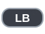

# Expanded Tricks 1.0.0 for Session: Skate Sim

Hippie jumps, grabs, no complies, bonelesses, finger flips and drop-ins for Session, with its own settings pages in the
pause menu. Source and releases: https://github.com/Portman2/SessionExpandedTricks

## What it adds

- **Hippie jumps.** Crouch with one stick and click the other stick: you jump, the board rolls on under you, you land
  back on it. Click both sticks for a mini hippie jump. Hold a trigger in the air to spin: a half turn is a 180 and
  lands you switch. *Hippie jumps* in the menu picks the animation: the jump, the game's ollie, or one or the
  other at random.
- **Grabs.** The game's own twelve grabs, switched on and finished. In the air hold LB (front hand, the left stick
  picks the grab) or RB (back hand, the right stick picks). Hold both bumpers for a two-hand grab: Cannonball (left stick
  up, right stick down), Quasimodo (both sticks up), Gorilla (no stick, or both sticks toward your toes), Truck Driver (front
  hand's stick toward your heels, back hand's toward your toes), Drunk Driver (the other way round) and Squirrel
  (both toward your heels). Moving a stick off the direction it picked a grab with tweaks it: *Grab tweak* in
  the menu picks between rotating (your legs and the board twist) and boning (your body goes back over the
  back foot and the board is poked out toward the nose).
  With the game's sticks set to *left foot / right foot*, LB is the left hand and RB the right, as the sticks are the
  left and the right foot: the two bumpers change places whenever your left foot is the back one (a regular rider
  riding switch, a goofy rider riding forward), for every grab, the boneless and the bean plant.
  Left and right on the stick are the sides of the board: push toward your toes for Mute or Indy, toward your heels
  for Melon or Stalefish. Your toes are on the right when you ride regular and roll forward, on the left when you
  ride goofy, and the other way round riding switch.
- **No comply.** The game's unused no-comply animation, on the pressure kickflip's input (riding regular: left stick
  down + right stick left). Regular and goofy, and riding switch.
- **Boneless and bean plant.** Hold RB (back hand) or LB (front hand) so a hand is on the board, then do a no comply.
  The game catches the board for you and the hand lets go as the board comes back under your feet; let the bumper go
  before the next grab. A bumper pressed late in the trick puts no hand on.
- **Rolling grabs and finger flips.** Riding on the ground, hold RB or LB to put a hand on the board. Flick a flip
  trick with the hand on and the hand flips the board.
- **Drop-ins.** On foot at the edge of a ledge, bank or ramp (within about 45 cm of it) with the board in your
  hand, press Y (Triangle). The board is set tail-down on the coping and you step on; push a stick up to drop
  in, LB or RB to step back, Y to step off. Tap Y twice to be put on in switch (facing away from the drop).
  Farther from an edge, Y is the game's own throwdown.
  Off a ramp the board tips down onto its face; off a plain ledge or wall you roll straight out; on a vert wall
  the speed you get goes with the wall's height (`DropInVertRef` in the ini is the height the two vert speeds of
  the Drop-ins page are for). As you drop in your arms come out for balance and you crouch, both by how big the
  drop is (sliders on the Drop-ins page); holding the crouch stick takes you further down.
- **Throwdown speed.** A slider on the General gameplay settings page: the game's own throwdown is played faster and
  you roll away faster, as a percentage of the speed you were moving at when you threw the board down. 100 % (as
  it ships) = unchanged.
- **Jumping onto the board.** On foot next to your board lying on the ground, click a stick. Run at it and
  your speed is carried onto the board.
- **Trick names** in the game's own trick display.
- **Settings in the pause menu** under *Expanded Tricks*, and everything else in `ExpandedTricks.ini`.
- **The Hippie Exterminator board.** A deck and a matching full-colour grip, both called *Hippie Exterminator* in the
  shop: the deck under **ThankYou** (in place of *Bad Clouds 8.25*), the grip under **DGK** (in place of *Serape*).
  They are loose files over the game's pak under `SessionGame\Content`; nothing in the pak is changed. To leave
  them out: `install.bat -NoBoard`.

## Requirements

- Session: Skate Sim on PC, from Epic or Steam. The mod was written against Epic's build of October 2026 (the launcher
  lists it as 1.0.6.42; its exe was built on 30 March 2026). On any other exe (Steam's is one, and so is any game
  update) it looks for the game's functions by their byte patterns when the game starts and runs only if it finds
  every one of them; otherwise it switches itself off and says so in `ExpandedTricks.log`. Steam's exe has been run
  by a tester (every function found) but not by the author: if the mod stays off, send the logs (see *Something wrong?*).
- Steam Deck / Linux: copy the files by hand (the installer is Windows-only) and set the game's launch option to
  `WINEDLLOVERRIDES="dwmapi=n,b" %command%` so the mod loader starts. Untested.
- A controller.
- UE4SS 3.0.1, the mod loader. **The installer puts it in for you if the game has none.** If you already use
  SessionOpenMP or SessionTweaks you have it, and it is left as it is.
- The Microsoft Visual C++ 2015-2022 Redistributable (x64), a current one. Most PCs with games have it; UE4SS does not
  start without it.

No other mod is needed. SessionOpenMP (co-op) and SessionTweaks can stay installed next to it.

Do not use it together with the *NoComplyWayBetter* mod: both put the no comply into the same trick.

## Install

1. Unzip the whole download somewhere (not inside the game's folder).
2. Close the game. Double-click **install.bat** (if Windows asks whether to run it, choose Run). It finds the game
   (Steam or Epic) and copies the mod in. If it cannot find the game, or finds more than one copy, it asks you. From a
   command prompt you can name the folder yourself: `install.bat -GameDir "D:\Games\Session"`.
3. Start the game. The first time, quit and start it once more: the mod switches on the game's own grab feature in
   its save, and the game only reads that at start-up. If you had never started the game before installing the mod,
   it takes one start more.

By hand instead: copy this package's `SessionGame` folder over the game's `SessionGame` folder, so that you end up with
`SessionGame\Binaries\Win64\Mods\ExpandedTricks` and `...\Mods\ExpandedTricksNative` (and the board's files under
`SessionGame\Content\Customization`; leave the package's `SessionGame\Content` folder out if you do not want the
board). If the game has no `UE4SS.dll` in
`SessionGame\Binaries\Win64`, also copy `UE4SS.dll`, `dwmapi.dll` and `UE4SS-settings.ini` from the package's `ue4ss`
folder there.

## Updating

The mod looks for a new version on its GitHub page each time you start the game. It downloads it, checks that it
carries the author's signature, and puts it in place for the next start. You are told on the trick display and in the
log. The *Automatic updates* row on the *General gameplay settings* page changes that: 2 = install by itself,
1 = only tell me, 0 = never look.

Your settings (`ExpandedTricks.ini`) are never part of an update.

## Controls

Shown for a regular rider; riding goofy or switch the sticks swap as they do for the game's own tricks.

| Trick | Input |
|---|---|
| Hippie jump |  +  &nbsp;or&nbsp;  +  |
| Mini hippie jump |  +  |
| Spin in a hippie jump |  &nbsp;or&nbsp;  held in the air |
| Grab, front hand |  +  in the air |
| Grab, back hand |  +  in the air |
| Two-hand grab |  +  in the air |
| No comply |  +  |
| Boneless |  +  +  |
| Bean plant |  +  +  |
| Rolling grab |  &nbsp;or&nbsp;  while riding |
| Finger flip |  &nbsp;or&nbsp;  + a flip trick's flick |
| Drop-in in switch |   (tapped twice) at an edge, on foot, board in hand |
| Drop-in |  at an edge, on foot, board in hand; then  to go,  /  to step back,  to step off |
| Jump onto the board |  &nbsp;or&nbsp;  near the board |

## Settings

Pause the game and open **Expanded Tricks**. Every row says what it does and in what unit, and ends with its default.
The pages: General gameplay settings, Hippie Jumps, Drop-ins, Grabs, Rolling Grabs and Finger Flips,
No Comply and Boneless.

Everything, including the fine tuning of each grab's hand, is in `ExpandedTricks.ini` beside the game's exe. The game
re-reads it every second, so you can edit and save while playing. Each line has a comment.

## Something wrong?

1. Run **`Mods\ExpandedTricks\pack-logs.bat`** in the game's `SessionGame\Binaries\Win64` folder.
2. It puts `ExpandedTricks-logs-<date>.zip` on your desktop (under 8 MB, so it fits in a Discord message). It holds
   the newest part of the logs. When they are longer than that, the older part goes into one or two more files
   beside it (`...-older-2.zip`, `...-older-3.zip`): keep those, and send them only if you are asked for more.
3. Send that file and say what you did and roughly when. Every log line has the time of day.

The zip holds the mod's logs and settings, UE4SS's log, SessionTweaks' log and settings if you have that mod, the
game's own settings files (your options: controls, gameplay and advanced settings, window and quality, so that
what you saw can be played again with your settings; no progress, inventory or account data), and a
short list of what is installed: your Windows version, the names of the folders in `Mods`, `mods.txt` and the path of
your game folder. That path, and the path of the game's save folder in the mod's first log, can show your Windows user
name. Nothing is sent anywhere by itself.

For a bad-looking pose, run `pack-logs.bat` soon after it happened: the mod records the skeleton of every trick you
do, and the zip carries the newest of them (about the last fifteen), so the pose can be looked at exactly as it was
on your screen. The recording is `ExpandedTricks.poses.bin` beside the logs (with the `.old` file it is set aside as
when full, 64 MB at most); `RecordPoses=0` in `ExpandedTricks.ini` switches it off.

## Uninstall

Double-click **uninstall.bat**. It removes the mod's two folders and the board's files (putting back any other mod's
files the installer had set aside as `.expandedtricks.bak`), and asks before removing your settings and logs,
and before removing UE4SS if this installer was what put it in and no other mod is left in `Mods`.

## Known limits

- Written against one game build; other builds (Steam, game updates) run only if the start-up check passes (see
  Requirements).
- The game's grab animations are unfinished; the mod poses the hand, arm, legs and deck on top of them. Odd poses
  happen, and the per-grab numbers in the ini are there to tune them.
- In the replay editor the mod's poses are replayed as recorded, not re-made.
- A goofy rider's switch no comply, boneless and bean plant are new in this build and little tested.

## Building from source

See `source/BUILD.md`. The Lua half is `SessionGame/Binaries/Win64/Mods/ExpandedTricks/Scripts/main.lua`; the native
half is one C++ file, `source/ExpandedTricksNative/hn_main.cpp`. `source/tools/make-release.ps1` puts a release
together and signs it.

## Licence

Copyright (C) 2026 Portman2. GPLv3 (`LICENSE`), with an added permission to run it inside the game (`LICENSE-EXCEPTION.txt`). Third-party notices are in `THIRD_PARTY.md`. This mod is not made or endorsed by the game's
developers.
